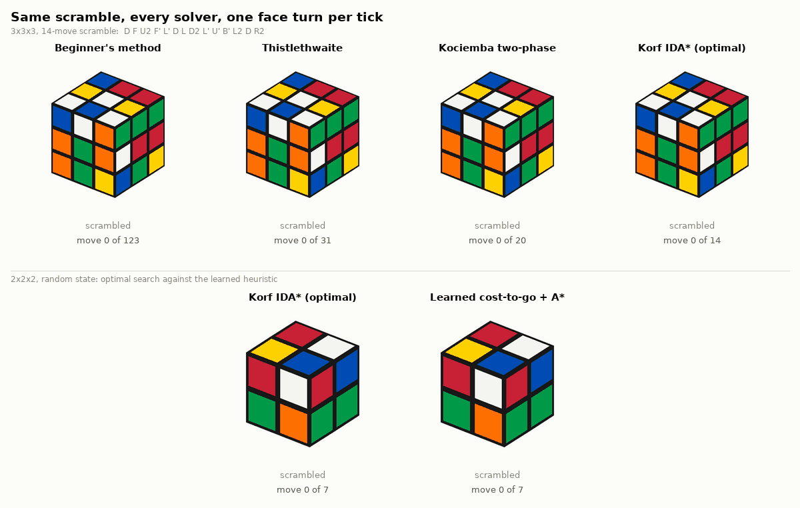
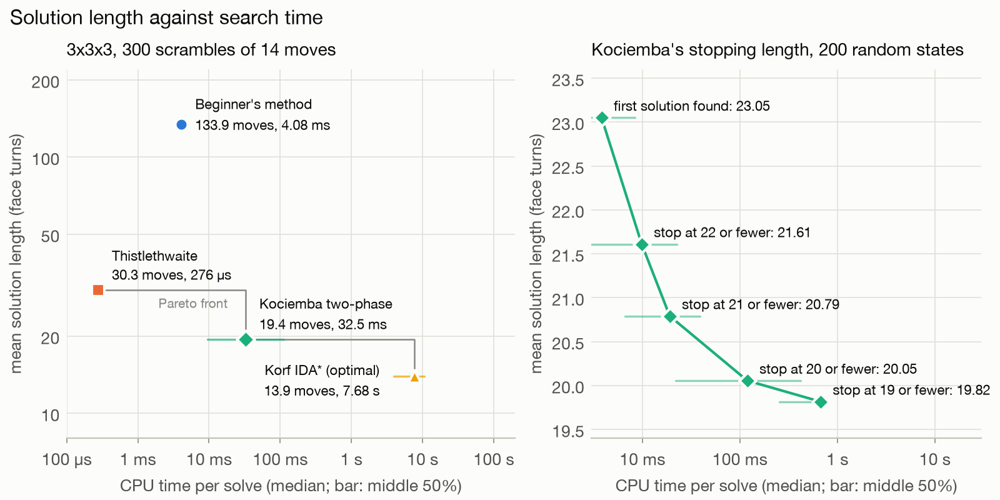
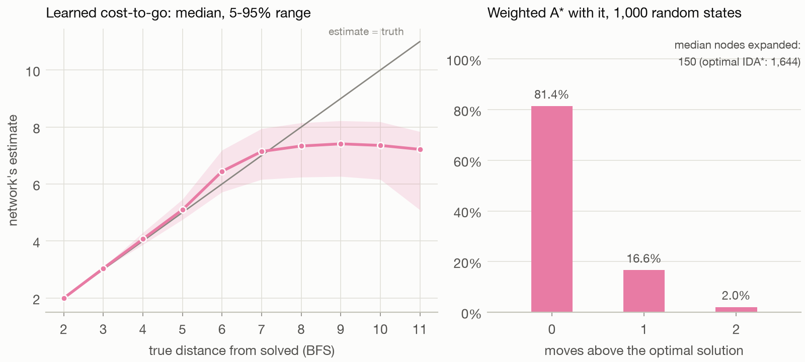

<div align="center">

# Solution length against search time for five Rubik's cube solvers

Lorenzo Caputi

</div>

**TL;DR.** Five Rubik's cube solvers written from scratch, from the layer-by-layer method people learn by hand to an optimal search, show how much search shorter solutions cost: 137 moves in 4 ms, 31 moves in 0.3 ms, 20 moves in a tenth of a second, and the shortest solution only on easier cubes, in seconds. On the 2×2×2 cube, a small neural network trained by reinforcement learning finds near-optimal solutions without ever being shown one.

## Abstract

Solving a Rubik's cube means finding a sequence of face turns from a scrambled position back to the solved one, in a graph of $4.3 \times 10^{19}$ positions where none is more than 20 moves from solved [5]. We implement five solvers from scratch and run them on the same scrambled cubes: the layer-by-layer method, Thistlethwaite's four-stage algorithm [1], Kociemba's two-phase algorithm [2], Korf's optimal search with pattern databases [3], and DeepCubeA [4], which learns the distance to solved by reinforcement learning and uses it to guide a search. On 1,000 random positions, the first three need 136.8, 31.0 and 20.1 moves on average, at median CPU times of 4.3 ms, 0.28 ms and 114 ms. The optimal search is too slow for random positions; on cubes scrambled with 14 turns it finds 13.9 moves in a median of 7.7 seconds. On the 2×2×2 cube, where breadth-first search gives the exact distance of all 3,674,160 positions, a network trained for 25 minutes on a laptop CPU finds the shortest solution for 81% of positions and is 0.2 moves from optimal on average.

<picture>
  <source media="(prefers-color-scheme: dark)" srcset="figures/race-dark.gif">
  
</picture>

**Figure 1.** The same scrambled cube solved by four of the methods, one face turn per frame. Below, a 2×2×2 cube solved by the optimal search and by the neural network.

## 1. Problem

A Rubik's cube has 8 corner pieces and 12 edge pieces that move. A position records where each piece is and which way it is turned, and the positions that can be reached by turning faces number

$$\frac{8! \cdot 3^8 \cdot 12! \cdot 2^{12}}{12} = 43{,}252{,}003{,}274{,}489{,}856{,}000.$$

A move is a quarter or half turn of one face, so every position has 18 neighbours, and solving the cube is a shortest-path problem on this graph. Every position can be solved in 20 moves or fewer, and about two thirds of them need exactly 18 [5]. The difficulty is the size of the search: even after obviously wasteful sequences are removed, the number of move sequences of length d grows like $13^d$ [3]. A solver either settles for longer solutions or finds a way to prune the search.

The 2×2×2 cube has only the 8 corners and 3,674,160 positions, few enough to compute the exact distance of every position by breadth-first search. None is more than 11 moves from solved, as listed in sequence A079761 of the On-Line Encyclopedia of Integer Sequences (OEIS) [6]. This makes it a test bed for a learned solver, whose answers can be compared with the optimum.

## 2. Solvers

- **Beginner's method.** Solves the cube one layer at a time with a few memorized move sequences, as people do by hand. No search at all.
- **Thistlethwaite [1].** Four stages, each restricted to a smaller set of turns than the last, so that each stage only has to bring the cube into the next subgroup. Every stage is read off a precomputed table of distances.
- **Kociemba [2].** Two stages like Thistlethwaite's, but searched together, so the search keeps looking for a shorter total until it finds one of 20 moves or fewer (or gives up after 2 million nodes).
- **Korf [3].** Iterative-deepening depth-first search that cuts any branch whose lower bound on the remaining moves is too long. The bounds are exact distances for the corners and for two halves of the edges, stored in tables of 175 MB. It always finds the shortest solution.
- **Reinforcement learning (DeepCubeA [4]), 2×2×2 only.** A neural network with three hidden layers of 512 units learns how many moves a position is from solved by approximate value iteration, a form of reinforcement learning, from positions made by scrambling the solved cube, without being shown any exact distance. A weighted A* search uses its estimates.

Every solution in the benchmark was applied to its scramble and checked to give the solved cube.

## 3. Results

**Table 1.** Mean solution length and median CPU time per cube, on 1,000 positions drawn uniformly at random.

| Solver | Moves | Time per cube |
|---|---:|---:|
| Beginner's method | 136.8 | 4.3 ms |
| Thistlethwaite | 31.0 | 0.28 ms |
| Kociemba | 20.1 | 114 ms |

Korf's search would take far too long on a random position, which is usually 18 moves away, so all four 3×3×3 solvers were also run on 300 cubes scrambled with 14 random turns. There Korf's search finds 13.9 moves in a median of 7.7 seconds, against 19.4 moves for Kociemba's algorithm, 30.3 for Thistlethwaite's and 133.9 for the beginner's method. Each step down in length costs a large step up in search (Figure 2). Kociemba's algorithm can also be stopped early: the first solution it finds has 23.1 moves after 4 ms, and asking for 19 moves or fewer gives 19.8 moves after 0.7 seconds. The beginner's method runs as plain Python and the others are compiled with numba, so the times compare implementations as well as algorithms.

<picture>
  <source media="(prefers-color-scheme: dark)" srcset="figures/time-vs-moves-dark.png">
  
</picture>

**Figure 2.** Left: mean solution length against median CPU time on the 300 cubes scrambled with 14 turns. Right: Kociemba's algorithm stopped at different target lengths, on 200 random positions.

On the 2×2×2 cube, the learned solver finds solutions of 9.0 moves on average against 8.8 for the optimal search, and the shortest solution for 81.4% of 1,000 random positions. Its network is accurate up to about 7 moves and then levels off, underestimating the farthest positions by up to 4 moves (Figure 3). It expands far fewer nodes than the optimal search (a median of 150 against 1,645), but each one needs a pass through the network, so it takes 13 ms per cube instead of 0.26 ms.

<picture>
  <source media="(prefers-color-scheme: dark)" srcset="figures/learned-vs-optimal-dark.png">
  
</picture>

**Figure 3.** Left: the network's estimate against the true distance of 2×2×2 positions. Right: how much longer the learned solutions are than the shortest ones.

The tables built along the way also check the cube model: Thistlethwaite's four stage tables have 2,048, 1,082,565, 29,400 and 663,552 entries, whose product is the number of positions above, and the 2×2×2 distance counts match OEIS term for term ([figure](figures/cube2-distances.png)).

## Reproducing the results

```sh
git clone https://github.com/lorenzocaputi/rubiks-cube-solvers.git
cd rubiks-cube-solvers
python3 -m venv .venv && . .venv/bin/activate
pip install -e ".[dev,figures]"
make benchmark && make figures
```

`make benchmark` runs all 7,000 solves in about 17 minutes on a laptop and writes `results/`; the first run also builds about 175 MB of lookup tables in `~/.cache/rubiks-cube-solvers`. `make figures` redraws the figures and the animation, `make check` runs the tests, and `make train` retrains the network (after `pip install -e ".[train]"`). Every solve can be replayed in 3D at https://lorenzocaputi.com/rubiks-cube-solvers/, or locally with `python -m http.server -d docs`; the viewer uses [cubing.js](https://github.com/cubing/cubing.js).

## References

1. M. B. Thistlethwaite's 52-move algorithm (1981), as described by J. Scherphuis. https://www.jaapsch.net/puzzles/thistle.htm
2. H. Kociemba. The two-phase algorithm. https://kociemba.org/math/twophase.htm
3. R. E. Korf. Finding optimal solutions to Rubik's Cube using pattern databases. *AAAI*, 1997. https://cdn.aaai.org/AAAI/1997/AAAI97-109.pdf
4. F. Agostinelli, S. McAleer, A. Shmakov and P. Baldi. Solving the Rubik's cube with deep reinforcement learning and search. *Nature Machine Intelligence* 1, 356–363, 2019. https://doi.org/10.1038/s42256-019-0070-z
5. T. Rokicki, H. Kociemba, M. Davidson and J. Dethridge. The diameter of the Rubik's cube group is twenty. *SIAM Journal on Discrete Mathematics* 27(2), 1082–1105, 2013. https://doi.org/10.1137/120867366; distance counts at https://cube20.org/
6. OEIS A079761, number of positions of the 2×2×2 cube at each distance. https://oeis.org/A079761
